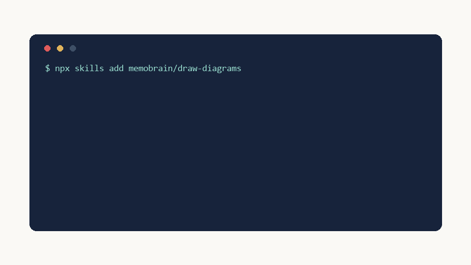

# draw-diagrams — an agent skill for mind maps



A [Agent Skills](https://www.anthropic.com/research/equipping-agents-for-the-real-world-with-agent-skills)
package (SKILL.md + one zero-dependency Python script) that teaches any
SKILL.md-compatible coding agent (Claude Code, Codex, Gemini CLI, Cursor,
Copilot, and 20+ others) to turn text into a real, editable mind map:

- **`<name>.svg`** — a clean static image for docs / PRs / chat.
- **`<name>.xdt`** — the editable source file (MemoBrain format).
- **A one-click link** — `https://app.memobrain.net/?import=…` opens the
  diagram in the browser, already laid out, fully editable. Free to edit, free
  account to save, membership for watermark-free export and more.
- **25 layouts** (`--layout fishbone`, `h-timeline`, `tree-table`, `matrix-h`…)
  and **9 color themes** (`--theme forest`, `blackboard`…) — carried by the link,
  baked into the `.xdt` (app's colorizeForTheme semantics: node/edge colors +
  straight/curve branch lines + canvas), and rendered in the `.svg` preview.

The generated `.xdt` stores the tree plus (for non-default themes) baked theme
colors — no coordinates ever. Layout and 30 layout modes happen inside
[MemoBrain](https://memobrain.net) when opened — the skill never guesses
geometry. CJK-aware text measuring keeps Chinese/Japanese/Korean labels inside
their node boxes.

## Install

One command (works with Claude Code, Codex, Cursor, Gemini CLI and other
agents the CLI detects):

```bash
npx skills add memobrain/draw-diagrams
```

Or copy this folder into your agent's skills directory:

| Agent | Location |
|-------|----------|
| Claude Code (personal) | `~/.claude/skills/draw-diagrams/` |
| Claude Code (project) | `.claude/skills/draw-diagrams/` |
| Tool-agnostic (many agents) | `~/.agents/skills/draw-diagrams/` |
| DeepSeek Harness | nothing to configure — it auto-discovers `~/.agents/skills/` |
| Others | any folder your agent discovers SKILL.md from |

Or clone directly:

```bash
git clone https://github.com/memobrain/draw-diagrams ~/.agents/skills/draw-diagrams
```

Requires Python 3.8+. No pip dependencies.

## Update

Re-run the one-liner — it installs the latest version in place:

```bash
npx skills add memobrain/draw-diagrams
```

Git-cloned installs update with `git -C ~/.agents/skills/draw-diagrams pull`; zip
installs just re-download and overwrite. The skill also **self-checks**: at most once
a day it compares its installed `version` against the repo's `VERSION` and tells the
user when an update is available — so installed users hear about new versions from
their agent the next time they draw.

## Try it

```bash
python scripts/xdt.py examples/product-launch.txt --link -o /tmp
```

Then just ask your agent: *"make a mind map of …"* — it will use the skill.

## License

MIT. Made for [MemoBrain](https://memobrain.net) — AI diagram workspace
(mind maps · flowcharts · architecture · knowledge base).

Affiliate program: <https://affiliates.creem.io/join/memobrain-affiliates>
